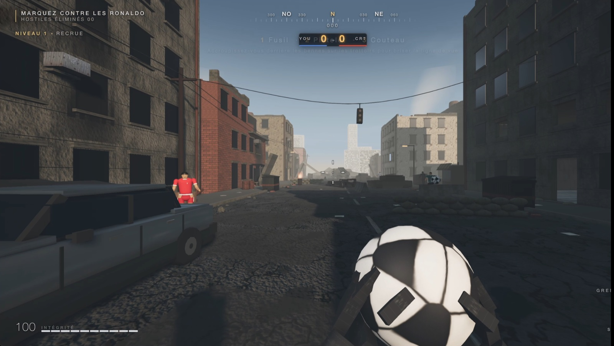
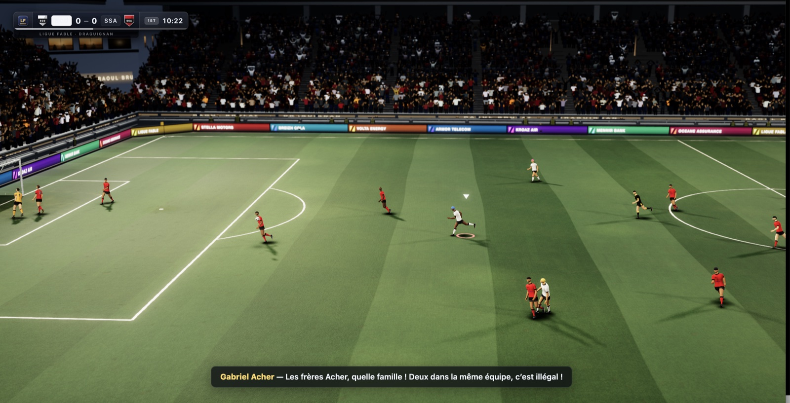

Il y a une semaine, j'ai collé [ce prompt de Matt Shumer](https://x.com/mattshumer_/status/2081100590612922527) (150 mots, pas une ligne de spec technique) dans [Claude Code](https://docs.anthropic.com/en/docs/claude-code), et je suis allé faire autre chose. En rentrant : un FPS jouable dans le navigateur. Pas une démo, pas un prototype. Un jeu. J'ai recommencé deux jours plus tard en remplaçant "Call of Duty" par "FIFA", et ça a marché aussi. Puis mon neveu de 10 ans a fait évoluer les deux jeux, en donnant des idées, en écrivant directement ce qu'il voulait dans le terminal de Claude, en jouant, en critiquant, et ainsi de suite, jusqu'à aujourd'hui.
Les deux jeux sont en ligne, jouables tout de suite (même sur téléphone !), sans installer quoi que ce soit :
- **[blog.mathieuacher.com/ashfall](https://blog.mathieuacher.com/ashfall/)** : le FPS, avec son mode coopératif à deux, ses décors, etc. ([démo vidéo](https://www.youtube.com/shorts/DUihik38JEA))
- **[blog.mathieuacher.com/fifacher](https://blog.mathieuacher.com/fifacher/)** : le foot, un match au Stade Raoul Brulat avec les cigales et deux joueurs d'exception. ([démo vidéo](https://www.youtube.com/shorts/CMiOrjE6TMY))

Vous cliquez, ça se lance. Sur téléphone, les joysticks tactiles apparaissent tout seuls. Sur ordinateur, c'est clavier-souris, et si vous branchez une manette (Switch en USB ou en Bluetooth, ou n'importe quel pad standard), elle est reconnue immédiatement. Rien à télécharger, rien à compiler, aucun compte à créer.

Ce qui a suivi le premier jet m'intéresse davantage que le premier jet lui-même. Et une précision qui vaut pour tout le reste de ce billet : à l'exception de ce prompt initial, **tout a été fait avec mon neveu de 10 ans**, qui ne connaît rien à la programmation. Les chiffres plus bas, les motos, les ennemis en plus, le mode multijoueur, les décors bretons : c'est une semaine à deux devant la console. Il a compris le principe en dix minutes. Voici ce que j'en retiens, chiffres à l'appui.



*CallOfAcher. L'objectif affiché en haut à gauche, "MARQUEZ CONTRE LES RONALDO", est une idée de mon neveu : on ne tire pas des balles, on tire des ballons de foot sur des CR7. Tout le reste, la ville en ruines, la boussole, le HUD, les véhicules, est généré en code. [Démo vidéo](https://www.youtube.com/shorts/DUihik38JEA).*



*FIFAcher, au Stade Raoul Brulat. La foule des tribunes est un seul objet de rendu. Les sponsors sur les panneaux LED (Breizh Cola, Kroaz Air, Menhir Bank, Armor Telecom) ont été inventés par le modèle, qui a préféré une ligue bretonne fictive aux vraies marques. En bas, le commentaire en direct réagit au fait que deux Acher se trouvent dans la même équipe. [Démo vidéo](https://www.youtube.com/shorts/CMiOrjE6TMY).*

## Un prompt, un jeu

Le prompt tient en un paragraphe. Il ne dit pas *comment* faire, il dit *ce qu'on veut* et *comment vérifier* :

> I want you to build a first-person shooter at the level of the most recent Call of Duty games. [...] Fan out sub-agents and have sub-agents tackle each one individually [...] have a separate sub-agent check it visually to ensure it looks triple A. That separate sub-agent should be a really harsh critic [...] Do this in ThreeJS. /loop until it's utterly perfect.

Pour FIFAcher, j'ai changé trois mots. C'est tout. Et le premier jet est jouable : on se déplace, on tire, ça tourne à 60 fps.

## Ce que ça met en branle

C'est là que j'ai voulu regarder sous le capot. J'ai analysé les logs de session, les commits et les transcripts de sous-agents. Le chiffre qui m'a le plus surpris n'est pas le nombre de lignes de code, c'est le nombre d'agents.

| | CallOfAcher (ASHFALL) | FIFAcher |
|---|---|---|
| Fenêtre de travail | 26 → 31 juillet | 28 → 31 juillet |
| Demandes qu'on a tapées | 45 | 15 |
| Sous-agents lancés | 56 | 36 |
| Tokens traités | 585 M | 562 M |
| Tokens générés | 1,03 M | 1,15 M |
| Logs de session | 465 Mo | 462 Mo |
| Commits | 14 | 12 |

Au total : **92 sous-agents**, **1,15 milliard de tokens traités**, **2,18 millions de tokens générés**, pour **60 demandes** tapées par nous. Le rapport est vertigineux : une phrase en français déclenche des heures de travail machine. Trois modèles se sont relayés selon les phases (Opus 4.8, Opus 5, Fable 5).

Le "nous" est littéral : sur ces 60 demandes, deux seulement sont les prompts initiaux. Tout le reste a été formulé à deux, et une bonne partie tapée directement par mon neveu. Ces chiffres ne décrivent donc pas une performance de la machine seule, mais ce qu'une semaine de conversation à deux, dont un enfant de 10 ans, arrive à mettre en mouvement.

Le pattern d'orchestration mérite un mot. Pour FIFAcher, la construction initiale a été un workflow de 10 agents en parallèle, un par sous-système (foule, pelouse, ballon, éclairage, commentaire audio, post-processing…), chacun écrivant son module contre un contrat d'interface partagé : un fichier `CONTRACT.md` de 14 Ko généré en amont. Deux heures quarante de mur, dix agents concurrents. Puis des rondes de "critiques sévères" qui prennent des captures d'écran et notent le résultat, jusqu'à ce que les scores plafonnent.

Cette boucle de vérification visuelle est le cœur du dispositif, et elle est *laborieuse*. ASHFALL a laissé **199 captures d'écran** dans le dépôt, FIFAcher 31, plus 37 petits scripts de vérification (`voicecheck.mjs`, `switchcheck.mjs`, `rendercost.mjs`…) que l'agent a écrits pour s'auto-inspecter. Il ne *voit* pas le jeu tourner : il le photographie, image par image, et raisonne sur les photos.

## Le coût

Je l'ai reconstruit depuis les logs, aux tarifs API publics : **entre 1 000 et 1 200 dollars** pour les deux jeux (la fourchette dépend du TTL de cache appliqué). C'est une reconstruction, pas une facture, puisque j'étais sur un abonnement, mais l'ordre de grandeur est bon.

Le plus instructif n'est pas le montant, c'est *où* part l'argent. Certainement pas dans le code produit. Sur 1,15 milliard de tokens, le code généré ne pèse que **2,18 millions de tokens, soit 0,19 % du volume**. Les 99,8 % restants sont du **contexte** : à chaque appel, l'agent se refait expliquer le jeu qu'il est en train de modifier. Sur 5 295 appels API, cela fait en moyenne **216 000 tokens de contexte par appel**, relus encore et encore.

| Poste | Volume | Part du coût |
|---|---|---|
| Lecture de contexte (cache) | 1,11 Md tokens | 55 % |
| Écriture de contexte (cache) | 36,3 M tokens | 39 % |
| **Code effectivement produit** | **2,18 M tokens** | **6 %** |

Autrement dit : **on paie à 94 % le fait de lire et relire les milliers de lignes existantes, et à 6 % seulement le code écrit**. C'est là que se joue le vrai coût, et c'est structurel. Plus le jeu grossit, plus la moindre évolution devient chère, y compris une évolution triviale. Ajouter une moto au cinquième jour coûte bien plus qu'ajouter la même moto au deuxième, non pas parce que la moto est plus compliquée, mais parce qu'il faut traverser tout l'existant pour la poser au bon endroit. On ne paie pas la fonctionnalité, on paie le contexte qu'elle oblige à parcourir. Un projet de 200 lignes se bricole pour quelques centimes ; le même geste sur 19 000 lignes coûte cent fois plus.

Et c'est le point douloureux. Ce n'est pas donné à tout le monde. Il faut aussi, a priori, des modèles frontier : je doute qu'un modèle deux crans en dessous tienne une boucle de 92 agents sans partir en vrille. Cela dit, je suis très confiant sur la démocratisation. Dans un an, ces 1 000 dollars en vaudront 50. Même aujourd'hui, on peut d'ores et déjà réduire drastiquement le coût en combinant des modèles plus légers et spécialisés avec des modèles frontier, ou en utilisant son expertise technique pour davantage cadrer le système agentique. Vu la répartition ci-dessus, c'est d'ailleurs sur le contexte qu'il faut agir en priorité : mieux découper les modules, mieux cibler ce qu'on donne à lire à l'agent, et ne pas laisser chaque sous-agent avaler tout le projet.  

## Tout le reste s'est fait à deux

C'est la partie que je n'avais pas anticipée. Une fois le jeu créé, l'étendre devient une conversation. Mon neveu demande, je reformule à peine, il écrit même directement dans la console, et l'agent code. En une semaine, on a ajouté :

- **tirer un ballon de foot** sur des ennemis (avec, il faut le dire, un cri de célébration "SIUU" sur la touche V) ;
- des **voitures et des motos** conduisables ;
- plus d'ennemis, des civils qui fuient les coups de feu ;
- des **décors réels** : la Vallée de Gandy, le Stade Vélodrome, et le bourg de Saint-Aubin-du-Cormier avec son étang et les ruines de son château ;
- des **réglages de difficulté** ;
- le support **manette**, quasi immédiat, grâce à la Gamepad API du Web ;
- un **mode mobile** avec joysticks tactiles ;
- un **mode coopératif en ligne** à deux joueurs, en **WebRTC pair-à-pair, sans serveur** : un code à 4 caractères, et on joue ensemble.

Le TL;DR : c'est *facile*. Un enfant de 10 ans y arrive et comprend très vite le principe. Oui, les temps d'attente sont longs, mais pendant ce temps on fait du vrai foot, des jeux de société, on se baigne, on vit, et on revient quand ça nous chante. Le cycle de développement épouse le rythme des vacances, ce qui est une phrase que je n'imaginais pas écrire un jour.

## La stack, ou pourquoi le Web change tout

Techniquement, c'est d'une simplicité désarmante, et c'est ça le point :

- **Three.js** (r185) et **rien d'autre** côté rendu. Aucun asset externe : toutes les textures, tous les modèles, tous les sons sont **générés en code**. La foule du stade de FIFAcher, ce sont des dizaines de milliers de supporters dans un seul `InstancedMesh`, donc un seul appel de rendu, avec un atlas de 64 cellules peint procéduralement sur un canvas, et un masque séparé pour ne teinter que les vêtements et jamais la peau.
- ~18 900 lignes de JavaScript pour ASHFALL, réparties en 19 modules ES.
- **Vite** pour le build, **Playwright/Puppeteer** pour les captures automatiques.
- **PeerJS/WebRTC** pour le co-op, le broker gratuit servant *uniquement* à la signalisation.
- Déploiement **statique sur GitHub Pages** via GitHub Actions. Zéro serveur, zéro infra, zéro coût d'hébergement.

C'est ce dernier point qui rend l'affaire réelle plutôt qu'anecdotique. Un `git push`, et le jeu est en ligne, pour n'importe qui, partout, immédiatement. Pas de store, pas de validation, pas de build par plateforme. Le même fichier `index.html` sert le gamin sur son téléphone dans le train et l'adulte avec sa manette devant son écran. Allez cliquer sur les deux liens du début, c'est plus rapide que de finir ce paragraphe.

## Ce qui ne marche pas

Soyons nets : **ce n'est pas le niveau d'un vrai Call of Duty ni d'un vrai FIFA**. L'écart est réel, et il a plusieurs causes.

**Le graphisme et la 3D.** C'est là que le fossé est le plus visible. Du procédural sans artiste, ça se voit.

**Les instructions parfois ignorées.** Il arrive qu'une fonctionnalité demandée ne soit tout simplement pas implémentée, sans que rien ne le signale. Il faut re-demander.

**La vérification reste de surface.** Les critiques-agents notent des captures d'écran, ils ne jouent pas. Résultat : des bugs et des glitchs un peu partout, y compris des choses qu'un humain repère en trois secondes de manette.

**La jouabilité et le tuning : dur, dur.** C'est le point le plus difficile. Régler la sensibilité, l'équilibrage, le "feel", ça demande des dizaines d'allers-retours, et c'est le domaine où l'agent est le plus démuni.

**La connaissance des décors est réelle mais mal restituée.** Sur le Vélodrome, le modèle *sait* des choses justes : la forme des virages, l'ambiance. Mais la restitution reste approximative. Sur d'autres décors, malgré une connaissance manifeste, le résultat est franchement bullshit. Il faut travailler bien plus.

Cela dit, une nuance amusante : pour FIFAcher, la faiblesse technique **devient presque une feature**. Le jeu ne se joue pas comme un FIFA, il force à trouver d'autres stratégies. Le gameplay est différent, pas seulement inférieur.

## Le vrai plafond

[Karpathy a posté](https://x.com/karpathy/status/2083749667410727319) une réflexion qui recoupe exactement ce que j'ai observé. Deux idées m'ont marqué.

La première : on quitte le territoire du "dessine-moi un pélican en SVG". Ces jeux relèvent d'une catégorie de tâches que **personne de sensé n'aurait entreprises**, trop custom, trop longues, aucun retour sur investissement. Les LLMs ont toute la patience du monde, donc on passe de "personne ne ferait jamais ça" à "pourquoi pas, c'est quasi gratuit". Des mondes hyper-personnalisés à la demande. C'est exactement notre expérience : Saint-Aubin-du-Cormier en jeu vidéo, ça n'existait pas et ça n'aurait jamais existé.

La seconde, plus sévère, explique mes bugs : **les modèles ne savent pas auditer leur propre travail** dans ce domaine, parce qu'ils ne perçoivent pas nativement la vidéo et ne jouent pas au jeu. Mes 199 captures d'écran sont la preuve matérielle de ce handicap : une boucle de vérification lente et douloureuse, là où un humain avec une manette tranche en cinq secondes.

Ce n'est pas qu'une impression. On a mesuré le phénomène dans un [papier récent sur la vérification visuelle imparfaite](https://arxiv.org/abs/2606.15693), en prenant TikZ comme cas d'étude : jusqu'où le raffinement itératif reste-t-il efficace quand le vérificateur lui-même n'est pas fiable ? Les vérificateurs visuels, LLM ou outillés, ne dépassent pas un **F1 de 0,815** pour déterminer si une instruction visuelle a bien été appliquée au code. Autrement dit : dans un cas sur cinq environ, la boucle "génère, regarde, corrige" se trompe sur son propre diagnostic. On observe aussi que le feedback n'aide vraiment que s'il identifie précisément le défaut de l'image et propose une correction actionnable, sinon il ajoute du bruit. Et si TikZ, qui produit des figures statiques en 2D, pose déjà ce problème, on imagine l'ampleur du gap sur un monde 3D animé qu'il faudrait *jouer* pour évaluer.

Tant que ce verrou tient, l'écart avec un vrai AAA restera.

## Le "wow", et les problèmes ouverts

**Chacun peut créer son jeu.** C'est ça, l'incroyable. Le nom des joueurs, les équipes, le stade, le décor : tout est personnalisable. Dans FIFAcher, l'équipe locale est composée de onze Acher, prénoms sur les maillots, chacun avec sa couleur de cheveux. Fini le temps où les add-ons étaient réservés aux hackers.

**Les droits d'auteur.** J'ai demandé d'incorporer du son sous licence (Jump pour l'entrée des joueurs) : refus net, et à raison. Mais la frontière est floue. Qu'est-ce qui m'interdit de mettre les vrais noms de joueurs ? Le modèle, lui, a tracé sa propre ligne sans qu'on le lui demande : il a dessiné des blasons *originaux* aux couleurs des clubs, en écrivant explicitement dans le README que les vrais écussons ne sont pas reproduits. Prudence apprise, pas règle explicite.

**Le multimodal ouvre la suite.** Plein de composants open source existent pour la modélisation 3D. Rien n'empêche de bâtir de vrais petits ateliers pour modéliser sérieusement les décors, les joueurs, les stades, avec l'IA évidemment. C'est le chaînon manquant du graphisme.

**Un FIFA "open" peut-il émerger ?** Techniquement, la brique est là. Mais je n'en suis pas si sûr, et pour une raison sociale, pas technique : une *plateforme* partagée peut-elle émerger quand n'importe qui peut partir avec son propre variant ? La personnalisation à l'extrême est peut-être l'ennemie de la masse critique.

**La frontière IA / dev de jeu.** On a développé dans la console. Si si. Et clairement, on avait envie d'éditer le jeu *dans* le jeu. Le prochain saut d'ergonomie est peut-être là.

**On n'a jamais regardé le code.** Jamais parlé du code, non plus, et tant mieux : c'est ce qui a rendu la collaboration avec un enfant de 10 ans possible. Mais il faut de l'expérience pour recadrer le modèle quand ça dérape, pour déployer, pour comprendre pourquoi ça rame. Pas beaucoup plus, à ce niveau de complexité. Le fameux fossé arrivera plus loin : quand la complexité et l'exigence monteront (un vrai AAA), il faudra se réapproprier certains éléments techniques.

Reste le plus simple, et c'est peut-être le vrai argument. Les deux jeux sont là, à une URL, gratuits, sans installation : **[ashfall](https://blog.mathieuacher.com/ashfall/)** et **[fifacher](https://blog.mathieuacher.com/fifacher/)**. Prenez une manette, ou votre téléphone, jouez cinq minutes. Vous verrez les coutures, elles sont nombreuses. Mais vous jouerez à quelque chose que personne n'aurait jamais pris le temps de fabriquer, écrit en une semaine de vacances par un chercheur et un gamin de 10 ans qui n'a pas lu une ligne de code. C'est ça, la nouvelle. Et ça n'a pas fini de bouger.

---

*Les deux jeux : [ashfall](https://blog.mathieuacher.com/ashfall/) ([code](https://github.com/acherm/ashfall), [démo vidéo](https://www.youtube.com/shorts/DUihik38JEA)) et [fifacher](https://blog.mathieuacher.com/fifacher/) ([code](https://github.com/acherm/fifacher), [démo vidéo](https://www.youtube.com/shorts/CMiOrjE6TMY)). Prompt initial de [Matt Shumer](https://x.com/mattshumer_/status/2081100590612922527) ([dépôt](https://github.com/mshumer/Claude-of-Duty/blob/main/prompt.md)), adapté pour le football.*

*Méthodologie des chiffres : reconstruction depuis les transcripts de session Claude Code (927 Mo de JSONL). Les requêtes sont dédupliquées par identifiant de message, et les sessions reprises (qui rejouent l'historique de la session précédente) sont fusionnées pour ne pas compter deux fois. Les "demandes" comptent uniquement ce qu'on a réellement écrit : les notifications automatiques de fin de tâche, les échos de commandes et les "continue" sont exclus. Le coût est estimé aux tarifs API publics (input, output, écriture et lecture de cache), pas relevé sur une facture. Modèles : Claude Opus 4.8, Opus 5 et Fable 5.*

*Sur la vérification visuelle : Charly Reux, Mathieu Acher, Djamel Eddine Khelladi, Clément Quinton, Olivier Barais, [Imperfect Visual Verification for Code Edition: A Case Study on TikZ](https://arxiv.org/abs/2606.15693), 2026.*

*Un avis, une idée, un bug trouvé ? mathieu.acher@irisa.fr*

```bibtex
@misc{acher2026callofacher,
  author = {Mathieu Acher},
  title = {Deux jeux 3D en une semaine de vacances, avec un neveu de 10 ans qui ne code pas},
  year = {2026},
  month = {aug},
  howpublished = {\url{https://blog.mathieuacher.com/CallOfAcherFIFAcherJeuxIA/}},
  note = {\url{https://blog.mathieuacher.com/CallOfAcherFIFAcherJeuxIA/}}
}
```
