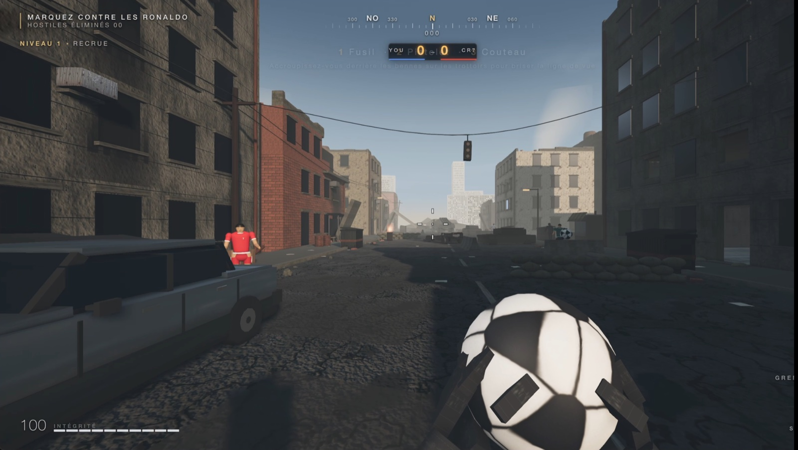
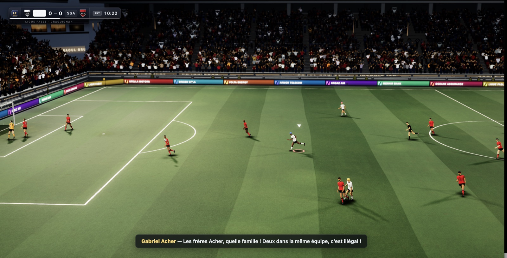

A week ago, I pasted [this prompt by Matt Shumer](https://x.com/mattshumer_/status/2081100590612922527) (150 words, not a single line of technical spec) into [Claude Code](https://docs.anthropic.com/en/docs/claude-code), and went off to do something else. When I came back: a playable FPS in the browser. Not a demo, not a prototype. A game. I did it again two days later, replacing "Call of Duty" with "FIFA", and that worked too. Then my 10-year-old nephew took over and grew both games, coming up with ideas, typing what he wanted straight into Claude's terminal, playing, criticizing, and so on, right up to today.
Both games are online, playable right now (even on a phone!), with nothing to install:
- **[blog.mathieuacher.com/ashfall](https://blog.mathieuacher.com/ashfall/)**: the FPS, with its two-player co-op mode, its environments, and so on. ([video demo](https://www.youtube.com/shorts/DUihik38JEA))
- **[blog.mathieuacher.com/fifacher](https://blog.mathieuacher.com/fifacher/)**: the football game, a match at Stade Raoul Brulat with cicadas and two exceptional players. ([video demo](https://www.youtube.com/shorts/CMiOrjE6TMY))

You click, it runs. On a phone, the touch joysticks appear on their own. On a computer it is keyboard and mouse, and if you plug in a controller (a Switch pad over USB or Bluetooth, or any standard gamepad), it is recognized immediately. Nothing to download, nothing to compile, no account to create.

What came after the first shot interests me more than the first shot itself. And one clarification that holds for the rest of this post: apart from that initial prompt, **everything was done with my 10-year-old nephew**, who knows nothing about programming. The numbers below, the motorbikes, the extra enemies, the multiplayer mode, the Breton environments: that is a week spent side by side at the console. He understood the principle in ten minutes. Here is what I take away from it, with numbers to back it up.



*CallOfAcher. The objective shown in the top left, "MARQUEZ CONTRE LES RONALDO" (score against the Ronaldos), is my nephew's idea: you don't fire bullets, you fire footballs at CR7s. Everything else, the ruined city, the compass, the HUD, the vehicles, is generated in code. [Video demo](https://www.youtube.com/shorts/DUihik38JEA).*



*FIFAcher, at Stade Raoul Brulat. The crowd in the stands is a single render object. The sponsors on the LED boards (Breizh Cola, Kroaz Air, Menhir Bank, Armor Telecom) were invented by the model, which preferred a fictional Breton league to real brands. At the bottom, the live commentary reacts to the fact that two Achers are on the same team. [Video demo](https://www.youtube.com/shorts/CMiOrjE6TMY).*

## One Prompt, One Game

The prompt fits in a single paragraph. It doesn't say *how* to do it, it says *what we want* and *how to check*:

> I want you to build a first-person shooter at the level of the most recent Call of Duty games. [...] Fan out sub-agents and have sub-agents tackle each one individually [...] have a separate sub-agent check it visually to ensure it looks triple A. That separate sub-agent should be a really harsh critic [...] Do this in ThreeJS. /loop until it's utterly perfect.

For FIFAcher, I changed three words. That's all. And the first shot is playable: you move, you shoot, it runs at 60 fps.

## What It Sets in Motion

This is where I wanted to look under the hood. I analyzed the session logs, the commits, and the sub-agent transcripts. The number that surprised me most is not the line count, it is the agent count.

| | CallOfAcher (ASHFALL) | FIFAcher |
|---|---|---|
| Working window | July 26 → 31 | July 28 → 31 |
| Requests we typed | 45 | 15 |
| Sub-agents launched | 56 | 36 |
| Tokens processed | 585M | 562M |
| Tokens generated | 1.03M | 1.15M |
| Session logs | 465 MB | 462 MB |
| Commits | 14 | 12 |

In total: **92 sub-agents**, **1.15 billion tokens processed**, **2.18 million tokens generated**, for **60 requests** typed by us. The ratio is dizzying: one sentence in French triggers hours of machine work. Three models took turns depending on the phase (Opus 4.8, Opus 5, Fable 5).

The "us" is literal: of those 60 requests, only two are the initial prompts. Everything else was formulated together, and a good share of it typed directly by my nephew. So these numbers do not describe the performance of the machine alone, but what a week of conversation between two people, one of them a 10-year-old, manages to set in motion.

The orchestration pattern deserves a word. For FIFAcher, the initial build was a workflow of 10 agents in parallel, one per subsystem (crowd, pitch, ball, lighting, audio commentary, post-processing, and so on), each writing its module against a shared interface contract: a 14 KB `CONTRACT.md` file generated beforehand. Two hours and forty minutes of wall clock, ten concurrent agents. Then rounds of "harsh critics" that take screenshots and score the result, until the scores plateau.

That visual verification loop is the heart of the setup, and it is *laborious*. ASHFALL left **199 screenshots** in the repository, FIFAcher 31, plus 37 small verification scripts (`voicecheck.mjs`, `switchcheck.mjs`, `rendercost.mjs`, and others) that the agent wrote to inspect itself. It doesn't *see* the game running: it photographs it, frame by frame, and reasons about the photos.

## The Cost

I reconstructed it from the logs, at public API rates: **between $1,000 and $1,200** for both games (the range depends on the cache TTL applied). It is a reconstruction, not an invoice, since I was on a subscription, but the order of magnitude is right.

The most instructive part is not the amount, it is *where* the money goes. Certainly not into the code produced. Out of 1.15 billion tokens, the generated code accounts for only **2.18 million tokens, that is 0.19% of the volume**. The remaining 99.8% is **context**: on every call, the agent has the game it is modifying explained to it all over again. Across 5,295 API calls, that averages **216,000 tokens of context per call**, read over and over.

| Item | Volume | Share of cost |
|---|---|---|
| Reading context (cache) | 1.11B tokens | 55% |
| Writing context (cache) | 36.3M tokens | 39% |
| **Code actually produced** | **2.18M tokens** | **6%** |

In other words: **94% of what you pay is reading and re-reading the thousands of existing lines, and only 6% is the code written**. That is where the real cost lies, and it is structural. The bigger the game gets, the more expensive the slightest change becomes, including a trivial one. Adding a motorbike on day five costs far more than adding the same motorbike on day two, not because the motorbike is more complicated, but because you have to traverse everything that already exists to put it in the right place. You are not paying for the feature, you are paying for the context it forces you to walk through. A 200-line project can be tinkered with for a few cents; the same gesture on 19,000 lines costs a hundred times more.

And that is the painful part. It is not within everyone's reach. You also need frontier models, presumably: I doubt a model two notches down would hold a 92-agent loop together without going off the rails. That said, I am very confident about democratization. In a year, those $1,000 will be worth $50. Even today, you can already cut the cost drastically by combining lighter, specialized models with frontier models, or by using your technical expertise to constrain the agentic system more tightly. Given the breakdown above, context is in fact where to act first: split the modules better, target more precisely what you hand the agent to read, and don't let every sub-agent swallow the whole project.

## Everything Else Was Done Together

This is the part I hadn't anticipated. Once the game exists, extending it becomes a conversation. My nephew asks, I barely rephrase, he even types directly into the console, and the agent codes. In a week, we added:

- **firing a football** at enemies (with, it must be said, a "SIUU" celebration cry on the V key);
- drivable **cars and motorbikes**;
- more enemies, civilians who flee from gunfire;
- **real environments**: the Vallée de Gandy, the Stade Vélodrome, and the village of Saint-Aubin-du-Cormier with its pond and its castle ruins;
- **difficulty settings**;
- **controller** support, almost immediate, thanks to the Web's Gamepad API;
- a **mobile mode** with touch joysticks;
- a two-player **online co-op mode**, in **peer-to-peer WebRTC, with no server**: a 4-character code, and you play together.

The TL;DR: it is *easy*. A 10-year-old can do it and grasps the principle very quickly. Yes, the waiting times are long, but meanwhile you play actual football, board games, you go for a swim, you live, and you come back whenever you feel like it. The development cycle follows the rhythm of the holidays, which is a sentence I never imagined writing.

## The Stack, or Why the Web Changes Everything

Technically, it is disarmingly simple, and that is precisely the point:

- **Three.js** (r185) and **nothing else** on the rendering side. No external assets: every texture, every model, every sound is **generated in code**. FIFAcher's stadium crowd is tens of thousands of supporters in a single `InstancedMesh`, hence a single draw call, with a 64-cell atlas painted procedurally onto a canvas, and a separate mask so that tinting only ever touches clothing and never skin.
- ~18,900 lines of JavaScript for ASHFALL, spread across 19 ES modules.
- **Vite** for the build, **Playwright/Puppeteer** for automatic screenshots.
- **PeerJS/WebRTC** for co-op, with the free broker used *only* for signalling.
- **Static deployment on GitHub Pages** via GitHub Actions. Zero servers, zero infra, zero hosting cost.

It is that last point that makes the whole thing real rather than anecdotal. One `git push`, and the game is online, for anyone, anywhere, immediately. No store, no review, no per-platform build. The same `index.html` file serves the kid on his phone on the train and the adult with a controller in front of a screen. Go click the two links at the top, it is faster than finishing this paragraph.

## What Doesn't Work

Let's be clear: **this is not the level of a real Call of Duty or a real FIFA**. The gap is real, and it has several causes.

**Graphics and 3D.** This is where the gap is most visible. Procedural work without an artist shows.

**Instructions sometimes ignored.** Sometimes a requested feature simply isn't implemented, with nothing to flag it. You have to ask again.

**Verification stays superficial.** The critic-agents score screenshots, they don't play. The result: bugs and glitches all over the place, including things a human spots in three seconds with a controller.

**Playability and tuning: hard, really hard.** This is the hardest point. Adjusting sensitivity, balance, the "feel", takes dozens of back-and-forths, and it is the area where the agent is most helpless.

**Knowledge of real places is genuine but poorly rendered.** On the Vélodrome, the model *knows* accurate things: the shape of the stands, the atmosphere. But the rendering stays approximate. On other environments, despite obvious knowledge, the result is frankly bullshit. Much more work is needed.

That said, an amusing nuance: for FIFAcher, the technical weakness **almost becomes a feature**. The game doesn't play like a FIFA, it forces you to find other strategies. The gameplay is different, not merely inferior.

## The Real Ceiling

[Karpathy posted](https://x.com/karpathy/status/2083749667410727319) a reflection that overlaps exactly with what I observed. Two ideas struck me.

The first: we are leaving the territory of "draw me a pelican in SVG". These games belong to a category of tasks that **nobody in their right mind would have undertaken**, too custom, too long, no return on investment. LLMs have all the patience in the world, so we go from "nobody would ever do this" to "why not, it's basically free". Hyper-personalized worlds on demand. That is exactly our experience: Saint-Aubin-du-Cormier as a video game did not exist and never would have.

The second, harsher, explains my bugs: **models cannot audit their own work** in this domain, because they do not natively perceive video and do not play the game. My 199 screenshots are the material proof of that handicap: a slow and painful verification loop, where a human with a controller settles it in five seconds.

This is not just an impression. We measured the phenomenon in a [recent paper on imperfect visual verification](https://arxiv.org/abs/2606.15693), using TikZ as a case study: how far does iterative refinement remain effective when the verifier itself is unreliable? Visual verifiers, whether LLM-based or tool-augmented, do not exceed an **F1 of 0.815** when determining whether a visual instruction has actually been applied to the code. In other words: in roughly one case out of five, the "generate, look, fix" loop is wrong about its own diagnosis. We also observe that feedback only really helps if it precisely identifies the flaw in the image and proposes an actionable correction, otherwise it adds noise. And if TikZ, which produces static 2D figures, already poses this problem, you can imagine the size of the gap on an animated 3D world that would have to be *played* to be evaluated.

As long as that lock holds, the gap with a real AAA will remain.

## The "Wow", and the Open Problems

**Anyone can create their own game.** That is the incredible part. Player names, teams, stadium, setting: everything is customizable. In FIFAcher, the home team is made up of eleven Achers, first names on the shirts, each with their own hair colour. Gone are the days when add-ons were reserved for hackers.

**Copyright.** I asked to incorporate licensed audio (Jump, for the players walking out): a flat refusal, and rightly so. But the boundary is blurry. What stops me from putting the real player names in? The model, for its part, drew its own line without being asked: it designed *original* crests in the clubs' colours, explicitly writing in the README that the real badges are not reproduced. Learned caution, not an explicit rule.

**Multimodality opens up what comes next.** Plenty of open source components exist for 3D modelling. Nothing prevents building real little workshops to seriously model the environments, the players, the stadiums, with AI of course. That is the missing link on graphics.

**Can an "open" FIFA emerge?** Technically, the building block is there. But I am not so sure, and for a social rather than technical reason: can a shared *platform* emerge when anyone can walk away with their own variant? Customization taken to the extreme may be the enemy of critical mass.

**The AI / game-dev boundary.** We developed in the console. Yes, really. And we clearly wanted to edit the game *inside* the game. The next ergonomic leap may well be there.

**We never looked at the code.** Never talked about the code either, and just as well: that is what made collaborating with a 10-year-old possible. But you do need experience to steer the model back when it drifts, to deploy, to understand why it lags. Not much more, at this level of complexity. The famous gap will show up further along: when complexity and expectations rise (a real AAA), you will have to reclaim some of the technical ground.

That leaves the simplest thing, and it may be the real argument. Both games are there, at a URL, free, with no installation: **[ashfall](https://blog.mathieuacher.com/ashfall/)** and **[fifacher](https://blog.mathieuacher.com/fifacher/)**. Grab a controller, or your phone, and play for five minutes. You will see the seams, there are many. But you will be playing something nobody would ever have taken the time to build, written in a week of holidays by a researcher and a 10-year-old who has not read a single line of code. That is the news. And it is far from finished moving.

---

*Both games: [ashfall](https://blog.mathieuacher.com/ashfall/) ([code](https://github.com/acherm/ashfall), [video demo](https://www.youtube.com/shorts/DUihik38JEA)) and [fifacher](https://blog.mathieuacher.com/fifacher/) ([code](https://github.com/acherm/fifacher), [video demo](https://www.youtube.com/shorts/CMiOrjE6TMY)). Initial prompt by [Matt Shumer](https://x.com/mattshumer_/status/2081100590612922527) ([repository](https://github.com/mshumer/Claude-of-Duty/blob/main/prompt.md)), adapted for football.*

*Methodology for the numbers: reconstruction from Claude Code session transcripts (927 MB of JSONL). Requests are deduplicated by message identifier, and resumed sessions (which replay the previous session's history) are merged so nothing is counted twice. The "requests" count only what we actually wrote: automatic task-completion notifications, command echoes, and "continue" messages are excluded. The cost is estimated at public API rates (input, output, cache write and cache read), not taken from an invoice. Models: Claude Opus 4.8, Opus 5, and Fable 5.*

*On visual verification: Charly Reux, Mathieu Acher, Djamel Eddine Khelladi, Clément Quinton, Olivier Barais, [Imperfect Visual Verification for Code Edition: A Case Study on TikZ](https://arxiv.org/abs/2606.15693), 2026.*

*This post is the English version of one originally published in French: [CallOfAcher et FIFAcher : vibe coder des variantes de jeux avec mon neveu de 10 ans](https://blog.mathieuacher.com/CallOfAcherFIFAcherJeuxIA/).*

*A comment, an idea, a bug found? mathieu.acher@irisa.fr*

```bibtex
@misc{acher2026callofacheren,
  author = {Mathieu Acher},
  title = {CallOfAcher and FIFAcher: Vibe Coding Game Variants with My 10-Year-Old Nephew},
  year = {2026},
  month = {aug},
  howpublished = {\url{https://blog.mathieuacher.com/CallOfAcherFIFAcherJeuxIAEN/}},
  note = {\url{https://blog.mathieuacher.com/CallOfAcherFIFAcherJeuxIAEN/}}
}
```
