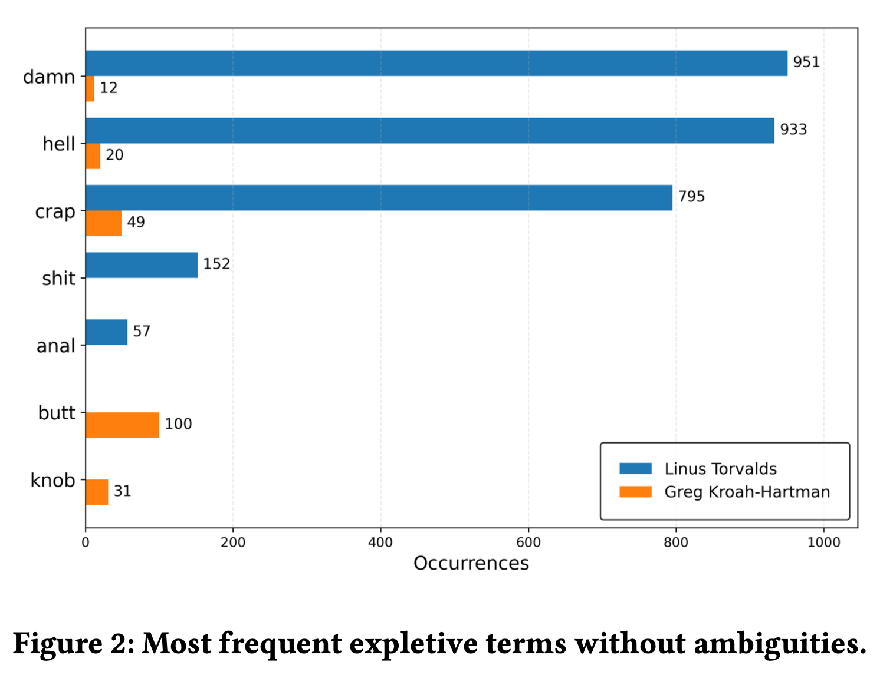

In our VEM 2026 (Workshop on Software Visualization, Maintenance and Evolution, co-located with CBSoft 2026) paper, *A Replication Study of Communication Style Analysis in the Linux Kernel Mailing List*, we rerun a classic 2016 analysis (Schneider, Spurlock & Squire, *Differentiating Communication Styles of Leaders on the Linux Kernel Mailing List*) on a modern dataset. Short answer: yes, they still sound different.

The original study showed that a classifier could tell the two kernel leaders apart just from how they write. We re-executed the same pipeline, Python 2.7 and all, on LKML5Ws, a curated dataset of 20M+ emails from 345 kernel mailing lists.

## What we found

📦 **"The data is public" ≠ "the data is usable."** Rebuilding the corpus from [lore.kernel.org](https://lore.kernel.org/) with `lei` worked for small time ranges but broke down at full-history scale (message bodies, thread completeness). So we switched to a curated dataset.

📊 **Classification.** On a balanced corpus of ~65.8k messages, Naive Bayes reaches F1 92.7% / accuracy 93.0% (original: 96.3% / 96.2%). Lower, but the stylistic signal clearly survives a different corpus.

✍️ **Style.** Linus writes shorter messages (279 vs 524 words), with more varied vocabulary and far more adverbs (5.2% vs 1.3%). His telltale words: *just*, *really*, *actually*, *think*. Greg KH's: *drivers*, *signed*, *struct*, *static*. Conversational vs. technical ;-)

🤬 **Expletives.** Linus still leads (4,653 vs 3,041), but raw counts mislead. String matching flags surnames like "wang", "cox" and "willy" as profanity, inflating the counts (these are real contributors!). Filter those out and the gap is stark: "damn" appears 951 times for Linus vs 12 for Greg.

*Most frequent expletive terms without ambiguities (Figure 2 of the paper).*

⚠️ **Caveats.** Some messages lack timestamps, so no temporal analysis yet. Next for us: LLM-based detection, longitudinal analysis, sampling sensitivity.

## Credits

Great job by Júlia Azevedo during her stay at INSA Rennes, together with Theo Canuto, Heraldo Borges and Juliana Alves Pereira from PUC-Rio.

- 📄 Preprint: [hal-05756009](https://inria.hal.science/hal-05756009)
- 💻 Artifacts: [github.com/aisepucrio/LKML-VEM2026](https://github.com/aisepucrio/LKML-VEM2026)
